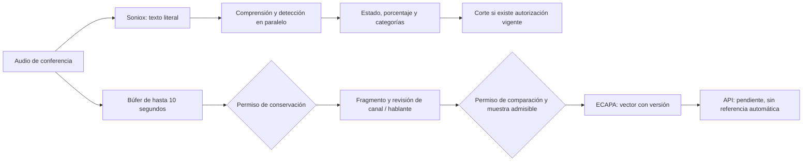

# Adaptación peruana, conductas y comparación de voz

18 de octubre de 2026, Lima. Caso de uso: conferencia de tres participantes (llamante, usuario y agente); la comparación vocal puede empezar después de escuchar unos segundos. Las categorías son hipótesis preventivas, no delitos confirmados ni identidades verificadas.

## Estudios y decisiones de implementación

| Fuente primaria | Aporte para Tiskz | Límite y aplicación |
| --- | --- | --- |
| Guevara-Rukoz et al. (2020), [Crowdsourcing Latin American Spanish for Low-Resource Text-to-Speech](https://aclanthology.org/2020.lrec-1.801/), y [OpenSLR 73](https://openslr.org/73/) | Audio transcrito de voluntarios peruanos; punto de partida para evaluar variación regional. | Se construyó para TTS, con frases de buena calidad. No es un corpus de conferencias, jergas espontáneas ni extorsión. Licencia CC BY-SA 4.0; separar hablantes entre entrenamiento y evaluación. No se descargó el corpus completo ni se entrenó Soniox. |
| Condori Pauccara (2024), [Interferencia morfosintáctica del quechua al castellano en la provincia del Cusco](https://doi.org/10.15381/lengsoc.v23i1.25908) | Describe una variedad andina en contacto con quechua, por un investigador de UNSAAC. | No existe una única forma peruana de hablar. No corregir una construcción regional como si fuera una señal de engaño; un estudio de Cusco no representa todo Perú. |
| [ASALE: causa](https://www.asale.org/damer/causa), [pata](https://www.asale.org/damer/pata) | Documenta tratamientos amistosos usados en Perú. | Son formas polisémicas. No prueban parentesco, identidad ni amenaza. El perfil contextual conserva el texto y evita disparadores por jerga. |
| [Lengua y Sociedad (2025): groserías y humor de los cómicos ambulantes de Lima](https://www.scielo.org.pe/scielo.php?pid=S2413-26592025000100018&script=sci_arttext&tlng=es) | Muestra que el contexto y los conocimientos compartidos cambian la función de una expresión aparentemente agresiva. | Habla escénica y humor no representan llamadas habituales. Justifica incluir contraejemplos; no permite ignorar una amenaza directa por llamarla broma. |
| Ma et al. (2025), [Detecting Continuously Evolving Scam Calls under Limited Annotation](https://aclanthology.org/2025.findings-emnlp.270/) | Propone discriminar conductas y contrastarlas con patrones legítimos para reducir falsas alertas ante narrativas cambiantes. | Sus datos no validan rendimiento en Perú. Tiskz añade casos negativos emparejados, evaluación por prefijo y categorías ancladas a citas; no añade varias inferencias secuenciales a la ruta de voz. |
| [Mininter: modalidades de extorsión](https://www.gob.pe/institucion/mininter/noticias/790416-pnp-intensifica-operativos-en-todo-el-pais-para-desarticular-mafias-de-extorsionadores) y [Poder Judicial: llamadas intimidantes](https://revistas.pj.gob.pe/revista/index.php/ropj/article/view/247) | Señalan coacción, cobro de cupos, supuestos secuestros y exigencias de pago como modalidades relevantes. | No sustituir la evaluación jurídica por un modelo. Se usan etiquetas como `posible_extorsion`, separadas de hechos y de relatos de amenazas recibidas. |
| Desplanques et al. (2020), [ECAPA-TDNN](https://www.isca-archive.org/interspeech_2020/desplanques20_interspeech.html), y [modelo oficial SpeechBrain](https://huggingface.co/speechbrain/spkrec-ecapa-voxceleb) | Embedding acústico de hablante, diferente de un embedding de transcripción. | VoxCeleb no representa una conferencia móvil peruana. La tarjeta advierte que no garantiza rendimiento en otros datos. Un coseno alto no es una probabilidad de identidad; no reutilizar el umbral del ejemplo o del panel como calibración local. |
| Li et al. (2022), [EDITnet](https://www.isca-archive.org/interspeech_2022/li22m_interspeech.html) | Documenta degradación por desajuste lingüístico y adaptación de dominio en verificación de hablante. | Validar muestras del mismo canal, duración, códec y condiciones reales. No extrapolar sus mejoras numéricas a Tiskz. |

## Cambios preparados

`prompts/es-PE.md` se incorpora a comprensión y detección. Reconoce tratamientos coloquiales, pagos locales, autoridad alegada y contexto de negaciones. No reescribe subtítulos ni cambia la configuración acústica de Soniox: el ensayo anterior con vocabulario sesgado mejoró una marca pero perdió una palabra crítica. No se afirma haber calibrado estadísticamente el porcentaje de riesgo.

`risk-segments.mjs` agrega `modalidades` a `assessment.update`: posible extorsión, posible fraude de credenciales/acceso/pago, petición económica por verificar, solicitud cotidiana y relato o denuncia. Usa únicamente evidencias ya ancladas a la transcripción; no crea una alerta por encontrar una palabra. La APK existente puede ignorar este campo adicional: no se implementó aquí una nueva pantalla de categorías.

`eval/peru-contexto-v1.json` contiene veinte conversaciones ficticias y cuarenta prefijos. Incluye saludo coloquial, pagos legítimos, coacción, OTP, supuesto soporte bancario, relatos, correcciones de montos, noticias e incertidumbre. Las etiquetas se usan para evaluar, nunca se envían al modelo. No es una muestra representativa ni un test independiente. Las pruebas unitarias comprueban anclaje, permisos y que las categorías no cambien el booleano del detector; no miden precisión del modelo.

## Conferencia de tres participantes

Tres participantes no significan tres pistas independientes. El canal `assistant` de Vapi es separable; `customer` puede mezclar las dos personas y eco del agente. El número entrante a Vapi también puede corresponder al usuario que agregó la conferencia: no usarlo como si acreditara el número original del llamante.

Se puede aprovechar la fase inicial con el usuario silenciado para obtener un tramo del llamante. El estado de silencio y el origen deben verificarse; no se deducen de que solo aparezca una frase en los subtítulos. Si habla el usuario, hay solapamiento, eco importante o procedencia dudosa, conservar el clip como mezcla autorizada para revisión y abstenerse de inscribirlo como referencia de una persona. Diarización no equivale por sí sola a atribuir cada voz al interlocutor correcto.



El guardado y la extracción quedan fuera de la ruta de respuesta y no deben retrasar el corte. Si el usuario autoriza conservar, la captura existente puede guardar una instantánea de hasta diez segundos al alertar. Una muestra demasiado corta o mezclada no se alarga manteniendo abierta una llamada de riesgo.

## Extractor local y API existente

`scripts/extraer-muestra-voz.py` usa SpeechBrain 1.1.2 y pesos oficiales ECAPA fijados al commit `0f99f2d0ebe89ac095bcc5903c4dd8f72b367286`. Acepta PCM16 mono 16 kHz, entre 3 y 15 segundos, con comprobaciones de energía y saturación. Estas comprobaciones no son VAD ni un detector de solapamiento validado. Exige permiso de comparación y revisión de un único llamante; el programa no demuestra por sí mismo esa condición. El resultado se guarda fuera de Git, sin subirlo a terceros ni activar referencias.

```bash
python3 -m venv .maritime/speaker-env
.maritime/speaker-env/bin/python -m pip install -r requirements-speaker.txt
.maritime/speaker-env/bin/python scripts/extraer-muestra-voz.py /ruta/privada/llamante.wav --consent-voice-comparison --reviewed-single-caller
```

La primera carga descarga pesos; un trabajador debe precargarlos y trabajar de forma asíncrona. No se incorporó Python ni este modelo a la VM de voz, ni se activó captura de nuevas llamadas reales.

`speaker-samples.mjs` prepara el cuerpo de `/api/v1/voice-samples`, exige permisos de almacenamiento y comparación, 192 componentes finitos, modelo/versión compatibles y revisión del canal. Mantiene `quality_status:pending`, `review_status:pendiente`, `reference_enabled:false` y perfil nulo. No escribe en producción. La API del panel ya propone vínculos dentro de una organización, con permisos de referencia y versiones compatibles; no devuelve los vectores a la APK.

## Bloqueo actual y llamadas posteriores

La alerta TRUE puede solicitar el corte de la llamada actual con el consentimiento de corte que ya maneja la APK. Las categorías y la conservación no conceden ese permiso. Un número bloqueado explícitamente por el usuario puede rechazarse desde Android antes de atender; eso no acredita quién controla el número ni evita suplantación o cambio de SIM.

Para recurrencia por voz hay que escuchar primero. Una similitud vocal ofrece un candidato para revisión, sujeto a calidad, canal y posible reproducción o clonación. Este cambio no corta automáticamente por coseno, no crea una lista pública de personas y no verifica identidades. El umbral debe validarse con hablantes distintos, mismo hablante en distintos teléfonos y falsos parecidos, separando entrenamiento, ajuste y prueba. Medir falsas coincidencias, omisiones, latencia y tasa de abstención, además de errores por dialecto y por calidad.

## Validación y publicación

`npm test`: 120 pruebas aprobadas. La extracción real con pesos oficiales produjo 192 componentes finitos y normalizados en un ejemplo TTS ficticio. La inferencia tardó 85 ms en el Mac de desarrollo, excluyendo importaciones, carga y descarga de pesos; no es una medida de la VM ni de telefonía. Se rechazaron silencio, audio corto, estéreo, frecuencia incorrecta y falta de permiso. La prueba no valida reconocimiento de hablantes reales ni una conferencia con voces superpuestas. Metadatos sin vectores en `eval/results/embedding-sintetico-2026-10-18.json`.

Evaluación por prefijos en la VM existente: cuarenta inferencias de cada variante. La versión anterior y la primera adaptación dieron una falsa alerta en un relato de amenaza a otra persona. Se delimitó el objetivo del detector a la acción sensible o coacción ejercida durante la llamada, conservando la distinción entre relato y amenaza. La variante refinada detectó los ocho positivos y no alertó en los diez negativos; los dos casos ambiguos no alertaron. No hubo alertas antes del turno decisivo. Es un corpus de desarrollo reutilizado para el ajuste, no una prueba independiente ni una calibración de riesgo real. Resultados conservados en `eval/results/peru-contexto-baseline-2026-10-18.json` y `eval/results/peru-contexto-refinado-2026-10-18.json`; la ejecución inicial permanece en `eval/results/peru-contexto-2026-10-18.json`.

Se publicó únicamente la adaptación de análisis y sus categorías sobre el runtime conocido: `5b3543236c6c68ceea0472375bb37f4e9f7cf8c72eef048a82370db7c2b38186`, anterior `f47d7bef21c368411df6869d87b86b6c86d2de5836e595378d693ce4487acdc6`. Se preservaron los demás archivos del paquete y el transcriptor Soniox base. Se comprobó ausencia de llamadas/monitores antes del cambio, escritura durable del paquete, hash del proceso tras reinicio y respuestas 200 en `/health` y `/chat`. No se modificó la APK ni se publicó el extractor Python. La captura telefónica permanece desactivada (`VAPI_PHONE_EVIDENCE_ENABLED=false`); comparación y conservación requieren sus permisos separados.

Prueba publicada de audio ficticio de 8 kHz por Vapi → Maritime → el canal de la APK, con permiso de corte activado: el relato de una amenaza a un tercero produjo FALSE, `observar`, categoría `relato_o_denuncia` e invitación a entrar; no solicitó colgar. Respuesta de voz: 1608 ms; alerta: 2113 ms desde el fin de la muestra. El proveedor terminó la sesión sin errores. No es una conferencia PSTN con tres personas físicas ni valida el objetivo máximo de 1500 ms. Resultado en `eval/results/peru-relato-integracion-2026-10-18.json`.
